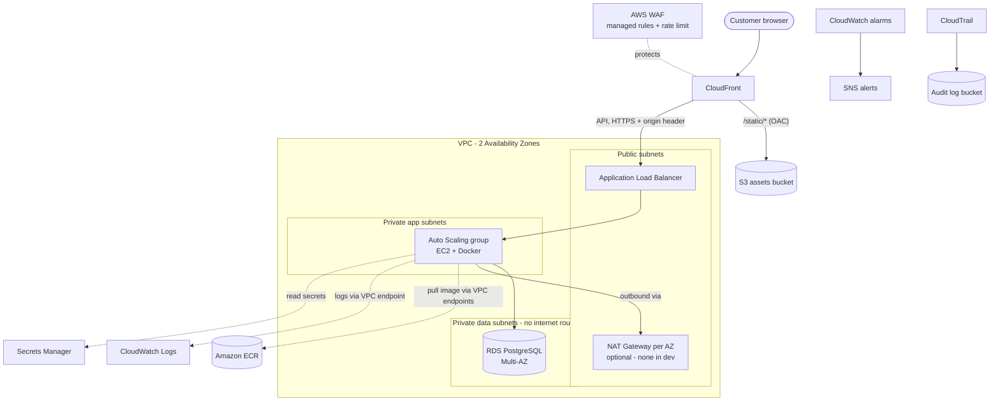

# Architecture

> **Status:** the network and compute layers (VPC, security groups, VPC
> endpoints, IAM instance role, ALB, launch template, Auto Scaling group) and
> the ECR repository are implemented. RDS, S3, Secrets Manager, CloudFront, WAF
> and monitoring are still scaffolding (`ImplementationStatus: PLACEHOLDER`).

## Overview

A classic three-tier, two-AZ web architecture for the FastAPI service in
[`app/`](../app/).

## Request flow

1. The client connects to **CloudFront** over HTTPS; **WAF** evaluates the request.
2. `/static/*` is served from the private **S3** assets bucket via Origin Access Control.
3. Everything else is forwarded to the **ALB**, which only accepts traffic from the
   CloudFront origin-facing prefix list and carrying a secret origin header.
4. The ALB forwards to healthy **EC2** instances in the private app subnets.
5. The app talks to **RDS PostgreSQL** in isolated data subnets on port 5432.

## Network layout (per environment)

| Tier    | Subnets       | Route to internet     | Hosts                     |
|---------|---------------|-----------------------|---------------------------|
| Public  | public-a / -b | Internet Gateway      | ALB, NAT Gateway(s)       |
| App     | app-a / -b    | NAT Gateway (egress), or none: VPC endpoints only | EC2 Auto Scaling group    |
| Data    | data-a / -b   | none                  | RDS primary + standby     |

`dev` uses `10.10.0.0/16` and no NAT Gateway: the app tier reaches ECR,
CloudWatch Logs and Systems Manager through interface VPC endpoints
(`network/endpoints.yml`, AZ a only) and S3 through the gateway endpoint.
`prod` uses `10.20.0.0/16`, one NAT Gateway per AZ and endpoints in both AZs.

## Stack layout

`cloudformation/main.yml` is the root stack. It creates one nested stack per
component and wires them together with `!GetAtt <Stack>.Outputs.<Name>`.

| Nested stack           | Template                       | Stage   | Depends on                         |
|------------------------|--------------------------------|---------|------------------------------------|
| NetworkStack           | network/vpc.yml                | network | -                                  |
| SecurityGroupsStack    | network/security-groups.yml    | network | Network                            |
| EndpointsStack         | network/endpoints.yml          | compute | Network, SecurityGroups            |
| IamStack               | security/iam.yml               | compute | - (ECR repo and log group by name) |
| LoadBalancerStack      | compute/alb.yml                | compute | Network, SecurityGroups            |
| LaunchTemplateStack    | compute/ec2.yml                | compute | Network, SecurityGroups, IAM       |
| AutoScalingStack       | compute/autoscaling.yml        | compute | Network, Endpoints, LoadBalancer, LaunchTemplate |
| AlertingStack          | monitoring/sns.yml             | full    | -                                  |
| SecretsStack           | security/secrets.yml           | full    | -                                  |
| StorageStack           | storage/s3.yml                 | full    | -                                  |
| DatabaseStack          | database/rds.yml               | full    | Network, SecurityGroups            |
| CdnStack               | networking/cloudfront.yml      | full    | LoadBalancer, Storage, WAF         |
| MonitoringStack        | monitoring/cloudwatch.yml      | full    | Alerting, LoadBalancer, ASG, Database |

Separate stacks, not nested: `storage/ecr.yml` as `<stack>-ecr` (the image must
exist before the compute stage, and the images must outlive it) and
`networking/waf.yml` as `<stack>-waf` in us-east-1.

`network/` holds in-VPC networking; `networking/` holds the edge layer
(CloudFront, WAF).

## Conventions

**Naming** - `<ProjectName>-<Environment>-<component>`, e.g. `ecommerce-dev-alb`.
Globally unique names (S3) append `<account-id>-<region>`. IAM roles are *not*
explicitly named so CloudFormation can replace them safely; they use the path
`/<ProjectName>/<Environment>/` instead.

**Tagging** - stack-level tags from `environments/<env>/parameters.json` are applied
by `scripts/deploy.sh` and propagate to all nested stacks and taggable resources:

| Tag          | Example                        |
|--------------|--------------------------------|
| Project      | aws-ecommerce                  |
| Environment  | dev / prod                     |
| Owner        | platform-team                  |
| CostCenter   | portfolio                      |
| ManagedBy    | CloudFormation                 |
| Repository   | aws-ecommerce-infrastructure   |
| Component    | network, database, ... (set per nested stack in `main.yml`) |

**Cross-stack references** - nested stack outputs only; no CloudFormation
Exports, so `dev` and `prod` cannot become coupled.

**Region** - `us-east-2`. A WAF web ACL attached to CloudFront must be created in
`us-east-1`, so the WAF template is deployed as a separate `us-east-1` stack
rather than nested under the root stack.

## Well-Architected mapping

| Pillar                 | How this design addresses it |
|------------------------|------------------------------|
| Operational excellence | All infrastructure as code, CI validation, change sets reviewed before execution |
| Security               | Private app/data tiers, least-privilege IAM, no SSH (SSM), encryption everywhere, WAF, secrets in Secrets Manager, OIDC instead of access keys |
| Reliability            | Two AZs, Multi-AZ RDS, ASG with ELB health checks and a readiness lifecycle hook, CloudFormation-managed instance refresh (launch before terminate, automatic rollback), NAT per AZ in prod |
| Performance efficiency | CloudFront caching for static assets, target-tracking scaling, Graviton (t4g) RDS |
| Cost optimization      | Environment-sized parameters (single NAT, single-AZ DB in dev), log retention, ECR lifecycle |
| Sustainability         | Right-sized burstable instances, scale-in when idle |
